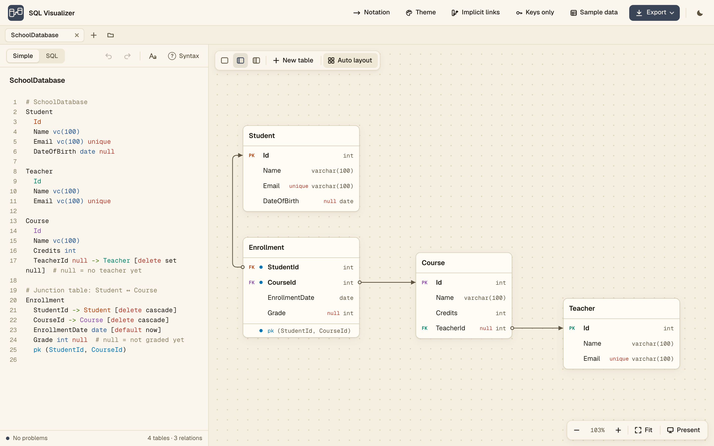
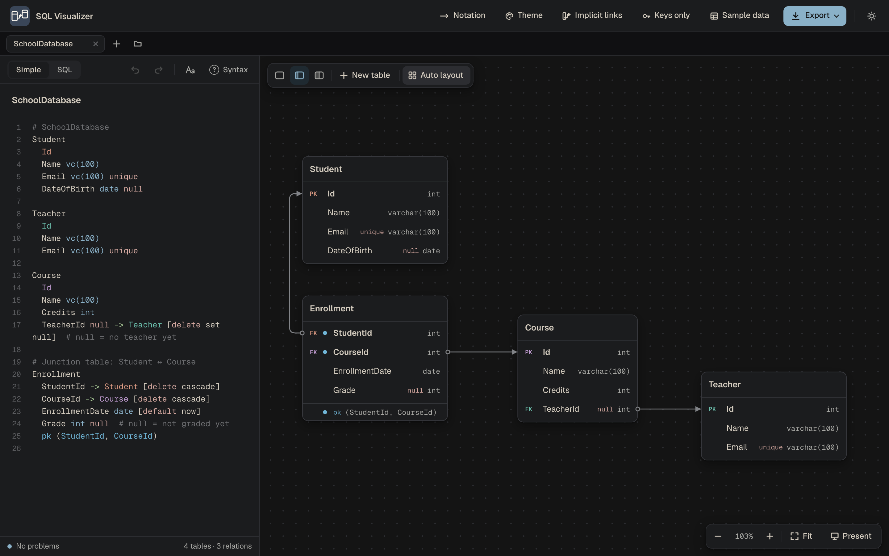
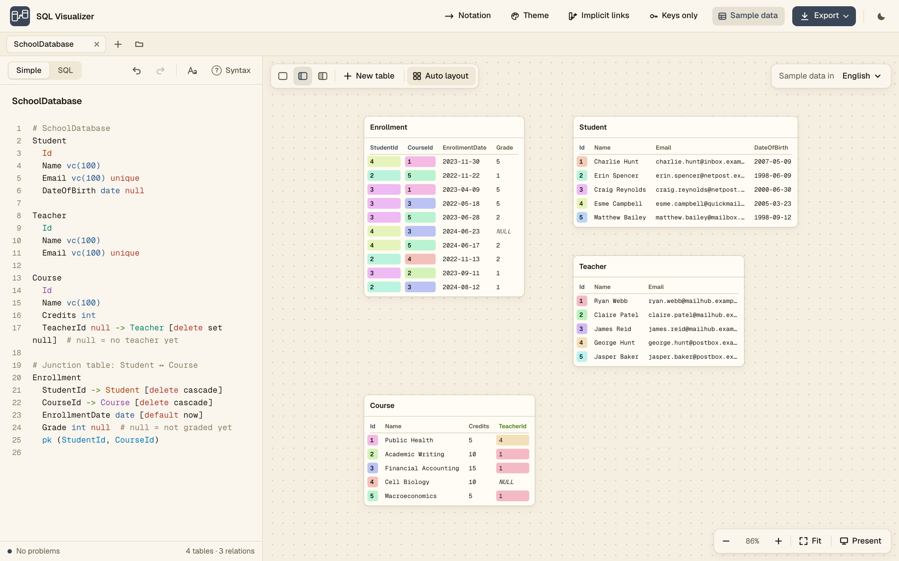
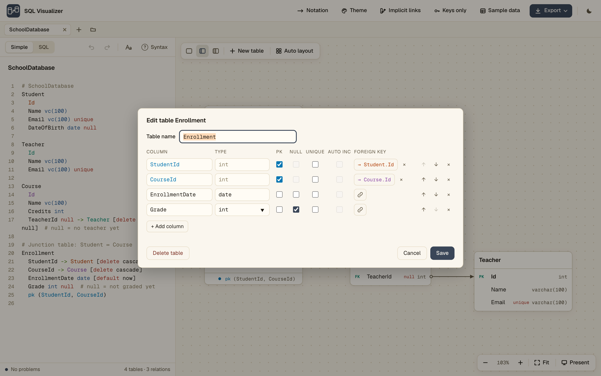
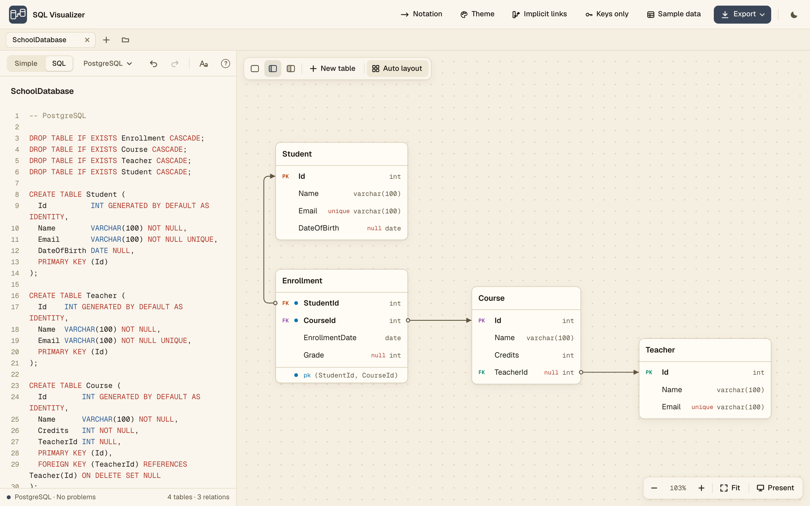
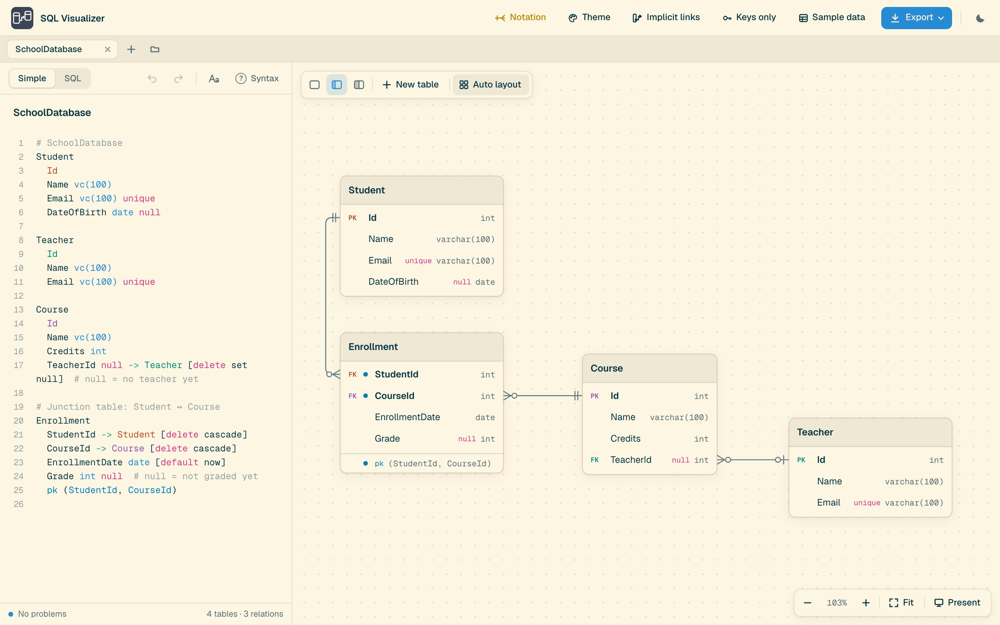
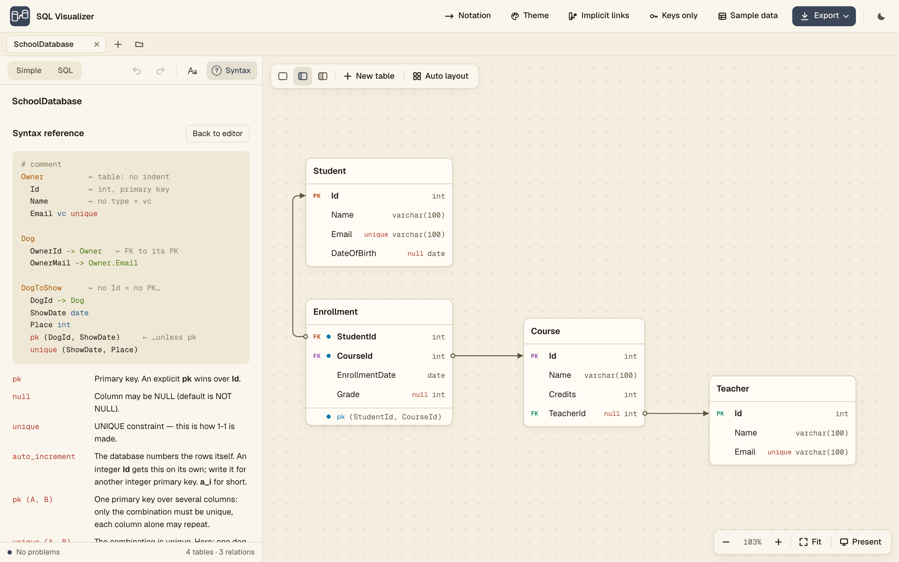

# SQL Visualizer

A browser tool for drawing SQL table diagrams. Arrows connect foreign-key columns directly to the columns they reference, making relationships and JOINs easy to follow.

[Open SQL Visualizer](https://trangius.se/sql_visualizer/)



- Write tables in a simple text format or SQL (MariaDB, MySQL, SQLite, PostgreSQL, SQL Server or Oracle); the diagram updates as you type.
- Drag tables to arrange them, or use auto layout.
- Export diagrams as SVG or PNG, and schemas as SQL for any of those.
- Keep multiple diagrams in tabs, with light and dark themes.

Diagrams are saved in your browser. Export a copy to keep your work outside it.

## Simple syntax

```text
# SchoolDatabase
Student
  Id
  Name vc(100)
  Email vc(100) unique
  DateOfBirth date null

Teacher
  Id
  Name vc(100)
  Email vc(100) unique

Course
  Id
  Name vc(100)
  Credits int
  TeacherId null -> Teacher [delete set null]  # null = no teacher yet

# Junction table: Student ↔ Course
Enrollment
  StudentId -> Student [delete cascade]
  CourseId -> Course [delete cascade]
  EnrollmentDate date [default now]
  Grade int null  # null = not graded yet
  pk (StudentId, CourseId)
```

| Syntax | Meaning |
| --- | --- |
| `Table` | A table: a line with no indent. Its columns are indented under it. |
| `# comment` | A comment, on its own line or after a column. |
| `Id` | An integer primary key with auto increment. A table without `Id` or `pk` has no primary key. |
| `Name` | A column with no type is `varchar(128)`. |
| `vc` | Short for `varchar(128)`. Other types are written as-is: `int`, `text`, `date`, `datetime`, `decimal(8,2)`, `vc(20)`… |
| `pk` | Primary key. An explicit `pk` wins over `Id`. |
| `null` | The column may be NULL (the default is NOT NULL). |
| `unique` | UNIQUE constraint; this is how a 1–1 relation is made. |
| `auto_increment` / `a_i` | The database numbers the rows itself. An integer `Id` gets this on its own. |
| `pk (A, B)` | One primary key over several columns: only the combination must be unique. |
| `unique (A, B)` | The combination of columns is unique. |
| `-> Table` | Foreign key to that table's primary key. The column takes its type. |
| `-> Table.Col` | Foreign key to a specific primary key or unique column. |
| `[delete cascade]` | Last on a `->` line: deleting the referenced row deletes this row too. `[delete set null]` empties the column instead (it must be `null`); `[update cascade]` follows a changed key. |
| `[default 0]` | The value when an INSERT leaves the column out: a number, `'text'`, `true`, `false` or `now`. Combine with commas: `[delete cascade, default 1]`. |
| `# e.g. A, B` | After a column: the values its sample data uses (**Sample data**, and the SQL export with it). |
| `OwnerId` | With **Implicit links** on, a column named table + `Id` gets an arrow to that table's primary key without `->`. Diagram only, not a foreign key in the SQL. |

The **Syntax** button in the app has the same reference.

## Run locally

Open `index.html` in your browser. No installation or build step needed.

## Screenshots

<table>
<tr>
<td align="center"><a href="docs/screenshots/dark.png"></a><br>Dark mode</td>
<td align="center"><a href="docs/screenshots/sample-data.png"></a><br>Sample data</td>
<td align="center"><a href="docs/screenshots/table-dialog.png"></a><br>Table dialog</td>
</tr>
<tr>
<td align="center"><a href="docs/screenshots/sql.png"></a><br>SQL (PostgreSQL)</td>
<td align="center"><a href="docs/screenshots/crows-foot.png"></a><br>Crow's foot, Solarized</td>
<td align="center"><a href="docs/screenshots/syntax.png"></a><br>Syntax reference</td>
</tr>
</table>
